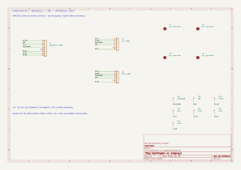
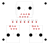
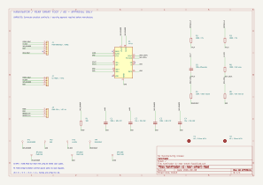
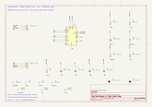

# Hankinator load-cell system — A0 approval package

**Approval-stage, unrouted KiCad 10 designs. No manufacturing release or Gerbers. Main V2 controller untouched.**

Three designs serve five physical boards: one splitter, two identical rear boards and two identical front boards. Existing cells operate successfully at 3.3 V according to the user; this is the supply basis. Qualification compares the new assembly and harness against that working baseline.

## Harness topology


```text
Controller (interface must match this table; controller PCB not changed)
  | 8P8C / CAT5e, 30 in maximum
  v
BREAKOUT, J1
  +-- J2 LEFT -- 6P6C, 24 in -- REAR LEFT J1 [HX711 -> rear-left cell]
  |                              J2 -- 4P4C, 12 in -- FRONT LEFT [HX711 -> front-left cell]
  +-- J3 RIGHT - 6P6C, 24 in -- REAR RIGHT J1 [HX711 -> rear-right cell]
                                 J2 -- 4P4C, 12 in -- FRONT RIGHT [HX711 -> front-right cell]
```

The reported “splitter to splitter” 12 in is interpreted as rear-to-front: this architecture contains one splitter. Longest controller-to-front path is 66 in (1.6764 m). This interpretation remains an input to confirm before harness fabrication.

## Exact harness specification HLC-A0

Contact numbers below are electrical mating contact numbers, never inferred from a left/right sketch. All cables preserve contact n to contact n. Telephone/handset leads are often reversed: do not substitute without a continuity check. Label all cables HANKINATOR SENSOR / NOT ETHERNET / NOT PHONE and LEFT or RIGHT as appropriate.

| 8P8C contact | T568B conductor | Signal | Twisted pair |
|---|---|---|---|
|1|White/orange|HX_SCK|Clock with ground|
|2|Orange|GND|Clock with ground|
|3|White/green|HX_FL|Left DOUT pair|
|4|Blue|3V3_SENSOR|Power / reserved pair|
|5|White/blue|RESERVED, isolated NC|Power / reserved pair|
|6|Green|HX_RL|Left DOUT pair|
|7|White/brown|HX_FR|Right DOUT pair|
|8|Brown|HX_RR|Right DOUT pair|

Use a normal straight-through T568B-to-T568B cable: all eight conductors may be physically installed but only seven are electrically used. With one allowed ground conductor, pairing clock with its return is preferred to pairing power with ground. Local capacitance supplies transient current; this assignment makes no Ethernet-compatibility claim.

| 6P6C contact | LEFT breakout J2 | RIGHT breakout J3 | Rear J1 function |
|---|---|---|---|
|1|HX_FL|HX_FR|FRONT_DOUT passthrough|
|2|HX_SCK|HX_SCK|Shared clock|
|3|3V3_SENSOR|3V3_SENSOR|Power|
|4|GND|GND|Ground|
|5|NC|NC|Isolated reserve|
|6|HX_RL|HX_RR|REAR_DOUT|

| 4P4C contact | Rear J2 and front J1 |
|---|---|
|1|FRONT_DOUT|
|2|HX_SCK|
|3|3V3_SENSOR|
|4|GND|

Specify branch conductors by numbered contact and continuity, not proprietary telephone wire colors. Use fully populated 6P6C plugs (not 6P2C/6P4C). For flat modular cable, record its stripe-to-contact relationship on the harness traveler. The rear FRONT_DOUT trace only joins J1.1 and J2.1; it has no connection to the rear HX711. Earlier proposed 6P6C pin 5 ground is superseded here by NC; do not mix harness revisions.

## HX711 implementation

Both foot designs use AVIA HX711, 3.3 V VSUP/DVDD, internal oscillator (XI grounded), RATE grounded for 10 SPS. Firmware selects channel A / gain 128 with the 25th pulse. BASE and XO are unconnected; VFB is grounded. The internal regulator is bypassed. VBG is unconnected in this mode, as permitted by the [AVIA reference datasheet](https://cdn.sparkfun.com/datasheets/Sensors/ForceFlex/hx711_english.pdf), also saved in references/hx711.pdf.

R1 (10 ohm) feeds local AVDD and bridge E+ from 3V3_SENSOR, with C1 100 nF and C2 10 uF to ground. E- and AGND share GND. C3 100 nF decouples DVDD, and C4 10 uF buffers incoming power. R2/R3 (100 ohm each) and C5 (100 nF differential) filter the bridge input symmetrically; nominal RC corner is 7.96 kHz excluding bridge impedance. These are interference filters, not a substitute for the ADC's 10 SPS rejection.

R4 (100 ohm) is the local DOUT source resistor. R5 (100 ohm) feeds only the local clock input, with R6 (100 kohm) holding it low. The shared clock passthrough bypasses R5. No regulator, level shifter or external pass transistor is required. Unused channel B inputs are grounded.

The bridge connector is keyed vertical JST-XH B4B-XH-A(LF)(SN): pin 1 E+ (AVDD), pin 2 E- (GND), pin 3 A+, pin 4 A-. Proposed cell colors are red/black/green/white respectively, subject to confirming the actual working cell harness before crimping. Do not identify a wire solely by color. Use matching XH housing and manufacturer-approved contacts for the actual wire gauge.

Bridge excitation and ADC reference share AVDD, retaining ratiometric operation. The 10 ohm resistor reduces excitation slightly: for a 350 ohm bridge and assumed 1.5 mA analog load, AVDD is approximately 3.19 V before cable drop. Bridge resistance is not established by the Amazon listing. Measure supply current and AVDD on the first assembled set; existing 3.3 V operation is evidence for the cells, not a completed test of this new filter and harness. Do not infer controller supply headroom from cell operation alone.

With an illustrative 24 AWG trunk resistance of 0.095 ohm/m per conductor and 26 AWG branch resistance of 0.134 ohm/m, 43 mA total / 21.5 mA per side / 10.75 mA per front yields approximately 10.6 mV round-trip wire drop at a front foot. This is a calculation using assumed cable resistance, excluding contacts; verify the selected cable specifications and measured current.

Firmware must wait for all four DOUTs low, clock/read all four streams together for 24 bits and issue the common 25th pulse. Keep clock idle low, high pulses below the datasheet 50 us maximum, and account for power-down above 60 us. Define timeout/disconnected-cell behavior. Firmware was not changed or validated in this task.

## Placement and mounting

Coordinates are millimetres from upper-left board outline, viewed from component side, X right and Y down. Two-layer, nominal 1.6 mm board. Routing is deliberately absent; a continuous ground plane and short symmetric analog routing are required at the routing stage.

| Board | Outline | Mounting hole centres (2.2 mm NPTH, M2) | Connector arrangement |
|---|---|---|---|
|BREAKOUT|50 x 44|(3.5,3.5), (46.5,3.5), (3.5,40.5), (46.5,40.5)|8P8C vertical top entry; 6P6C LEFT/RIGHT toward bottom edge|
|REAR SMART FOOT|72 x 18|(22,3.5), (55,14.5)|6P6C left narrow end; 4P4C right narrow end|
|FRONT SMART FOOT|56 x 18|(22,3.5), (52,14.5)|4P4C left narrow end|

Both foot boards place the keyed bridge connector near HX711. An 18 mm board width leaves 2 mm total within the 20 mm housing envelope for walls and clearance; printed fit must be checked. Allow space for plug bodies, latch access, wire bend radius and solder tails. Jack body heights: 8P8C 16.38 mm; 6P6C 12.57 mm; 4P4C 14.5 mm, before PCB thickness and underside clearance. The complete connector/cable envelope is not just the PCB outline.

Role, A0 revision, directions and pin references are included on board silkscreen, with some service text on the underside. JST signals are labeled. Each foot has TP1 power, TP2 ground, TP3 clock, TP4 local DOUT. The breakout exposes all seven live signals. Mounting courtyards reserve clearance for simple standoffs; final screw-head and enclosure tolerances remain mechanical checks.

## Jack procurement and qualification

Stock below is the observed research snapshot collected September 8–9, 2026, not reserved inventory. Recheck at order time. The selected jacks are through-hole, unshielded, without magnetics. **JLCPCB assembly acceptance for the selected modular jacks is unresolved.** Their manufacturer drawings and CAD were preferred over substituting an in-stock but mechanically unverified footprint.

| Function / total system quantity | Manufacturer MPN | LCSC identification | Observed stock | JLCPCB status |
|---|---|---|---|---|
|8P8C / 1|Wurth 615008144221|C6461975 catalog listing; procurement unconfirmed|[DigiKey 678](https://www.digikey.com/en/products/detail/w%C3%BCrth-elektronik/615008144221/2627290)|Not confirmed; quote/consignment or external THT assembly required|
|6P6C / 4|Wurth 615006143621|Exact catalog ID not verified|[DigiKey 3,630](https://www.digikey.com/en/products/detail/w%C3%BCrth-elektronik/615006143621/16608579)|Not confirmed|
|4P4C / 4|Wurth 615004143821|Exact catalog ID not verified|[DigiKey 3,207](https://www.digikey.com/en/products/detail/w%C3%BCrth-elektronik/615004143821/2627285)|Not confirmed|
|HX711 / 4|AVIA HX711|C43656|[LCSC 8,678](https://www.lcsc.com/product-detail/C43656.html)|[Extended SMT](https://jlcpcb.com/partdetail/HX711/C43656); JLC stock separately unverified|
|Bridge header / 4|JST B4B-XH-A(LF)(SN)|C144395|[LCSC 95,090](https://www.lcsc.com/product-detail/C144395.html)|[Assembly listing](https://jlcpcb.com/partdetail/JST-B4B_XH_A_LF_SN/C144395); confirm process quote|

[8P8C manufacturer drawing](https://www.we-online.com/components/products/datasheet/615008144221.pdf), [6P6C drawing](https://www.we-online.com/components/products/datasheet/615006143621.pdf), [4P4C drawing](https://www.we-online.com/components/products/datasheet/615004143821.pdf). Saved drawings and manufacturer Eagle library accompany the package. No footprint substitution is approved by matching “RJ” names alone.

## Physical orientation audit

All footprints are on F.Cu, viewed through the component side. Manufacturer Eagle XY coordinates were converted only by reversing Y for KiCad's downward Y convention. Placement uses rotation, never a footprint mirror. The saved PCB pad coordinates and drills were checked against the source drawings/CAD. Square pad identifies pin 1. These are documentary checks, not a measurement of a delivered jack.

| Jack | Native footprint direction / latch | Contact order looking into jack mouth | Opposing plug mating-tip view, same latch position |
|---|---|---|---|
|615008144221|Vertical opening +Z; latch toward -Y|With latch at top: 8,7,6,5,4,3,2,1 left to right|With latch at top: 1,2,3,4,5,6,7,8|
|615006143621|Horizontal mouth +Y; tab down|With latch at bottom: 1,2,3,4,5,6|With latch at bottom: 6,5,4,3,2,1|
|615004143821|Horizontal mouth +Y; tab up|With latch at top: 4,3,2,1|With latch at top: 1,2,3,4|

Plug mating-tip view means looking directly at the tip that enters the jack, not looking down onto the gold contacts. Opposing mating-face views necessarily appear mirrored. A solder-side board view also reverses apparent left/right: never transfer that view directly to a component-side footprint. Use the numbered tables and physical continuity test as the fabrication authority.

Native component-side signal-pad coordinates relative to each footprint origin:

| Contact | 8P8C X,Y | 6P6C X,Y | 4P4C X,Y |
|---|---|---|---|
|1|4.445, 4.65|-3.175, -7.71|1.53, -1.8|
|2|3.175, 7.19|-1.905, -5.17|0.51, -4.34|
|3|1.905, 4.65|-0.635, -7.71|-0.51, -1.8|
|4|0.635, 7.19|0.635, -5.17|-1.53, -4.34|
|5|-0.635, 4.65|1.905, -7.71|—|
|6|-1.905, 7.19|3.175, -5.17|—|
|7|-3.175, 4.65|—|—|
|8|-4.445, 7.19|—|—|

Signal drills are 0.9 mm. Locator NPTH: 8P8C at (+/-5.715,-1.7), 3.17 mm; 6P6C at (+/-5.08,1.18), 3.25 mm; 4P4C at (+/-5,0.5), 2.36 mm. The 4P4C split mounting feature has a larger barb than its nominal shaft; use the specified board drill.

See [placed physical pin mapping](PHYSICAL-PINS.md) for every modular jack's actual PCB pad coordinate, net and contact number, and [desk audit](verification/desk-audit.md) for check details.

## Validation and release gate

Native KiCad ERC: **0 violations for each schematic**. Native preliminary DRC: **0 non-connectivity violations**; intentionally unrouted connections: breakout 17, rear 40, front 36. No traces or ground zones have been added. These are not final clean routed boards.

The independent-representation desk audit passed **317 checks, 0 failed**, comparing exported KiCad netlists, saved PCB pads, manufacturer-coordinate expectations, and a five-board harness graph. It verifies each DOUT reaches its intended controller contact and remains separate from the others. It is a same-author check, **not an independent human review or physical continuity certification**.

Before routing/final release, resolve: (1) acceptance of the listed interface and 12 in rear/front assumption; (2) selected modular-jack JLC assembly route or a newly verified stocked substitute; (3) housing opening/height/latch/plug clearance; (4) actual load-cell wire order and connector contacts. Before Gerbers, obtain an independent end-to-end review and a power-off sample harness check: every jack solder pin to its mating plug contact, all cable n-to-n paths, NC isolation, no cross-short between power/ground/DOUT, and correct rear/front identity on both sides. Record instrument readings and reviewer identity. Do not energize a cable just because it resembles a straight-through telephone lead.

After routing: run native ERC/DRC and schematic/PCB parity again, require zero unrouted items, inspect copper/return paths, check jack fit with physical parts, then regenerate the full manufacturing set together. First-article validation should compare zero/span/noise with the existing 3.3 V modules, all four channels running, at maximum cable lengths.

## Editable designs and review drawings

Open each .kicad_pro in KiCad 10; the local footprint table resolves ../libraries. Keep the extracted directory structure intact.

### breakout

[KiCad project](hankinator-lc-breakout/hankinator-lc-breakout.kicad_pro) · [schematic](hankinator-lc-breakout/hankinator-lc-breakout.kicad_sch) · [PCB](hankinator-lc-breakout/hankinator-lc-breakout.kicad_pcb) · [ERC](hankinator-lc-breakout/checks/erc.rpt) · [preliminary DRC](hankinator-lc-breakout/checks/preliminary-drc.rpt)





### rear-smart-foot

[KiCad project](hankinator-lc-rear-smart-foot/hankinator-lc-rear-smart-foot.kicad_pro) · [schematic](hankinator-lc-rear-smart-foot/hankinator-lc-rear-smart-foot.kicad_sch) · [PCB](hankinator-lc-rear-smart-foot/hankinator-lc-rear-smart-foot.kicad_pcb) · [ERC](hankinator-lc-rear-smart-foot/checks/erc.rpt) · [preliminary DRC](hankinator-lc-rear-smart-foot/checks/preliminary-drc.rpt)




### front-smart-foot

[KiCad project](hankinator-lc-front-smart-foot/hankinator-lc-front-smart-foot.kicad_pro) · [schematic](hankinator-lc-front-smart-foot/hankinator-lc-front-smart-foot.kicad_sch) · [PCB](hankinator-lc-front-smart-foot/hankinator-lc-front-smart-foot.kicad_pcb) · [ERC](hankinator-lc-front-smart-foot/checks/erc.rpt) · [preliminary DRC](hankinator-lc-front-smart-foot/checks/preliminary-drc.rpt)




See [BOM](BOM.md) for per-design quantities and [design manifest](design-manifest.json) for net assignments and component placement coordinates.
